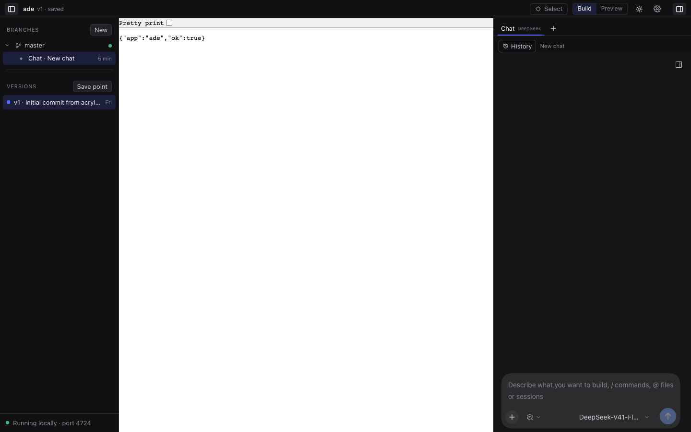

# ACRYL ADE, a community instance by Andreas Petersson

This repository is Andreas Petersson's community instance of **ACRYL ADE**, the Agent Development Environment, started from the `acryl.ade` Blueprint at the ACRYL Bootcamp, Vienna, 20 November 2026.

- GitHub: <https://github.com/apetersson>
- Starter Blueprint: <https://acrylblends.github.io/blends/ai/ade/acryl.ade>
- Upstream: <https://github.com/acrylblends/05-acryl-ade>
- ACRYL Bootcamp: <https://github.com/acrylworkshop/bootcamp-2026-11-20>

This is the app as it ran that day (version 0.2.1), published as a community instance. The README below is the upstream one.
